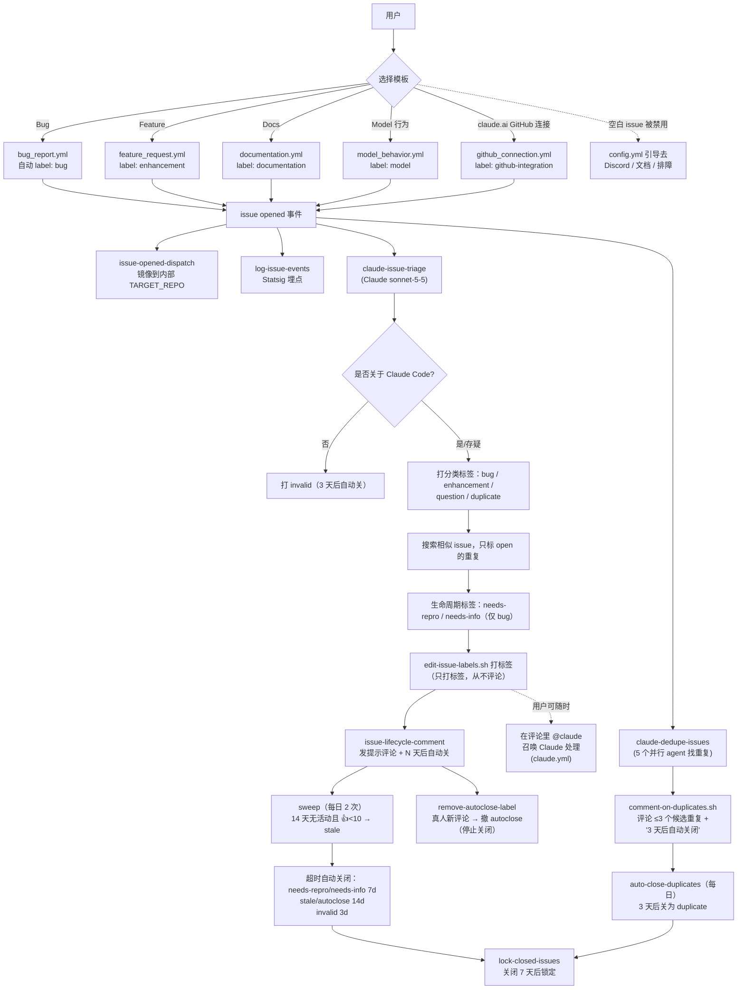

# Claude Code 开源社区洞察报告

> 调研对象：Anthropic 的 `anthropics/claude-code` GitHub 仓库及其 Discord 社区
> 调研目标：洞察「AI 时代开源社区的入口变化」
> 数据获取时间：2026-11-04（所有数字为该时点快照）
> 调研方式：一手来源（GitHub API + raw.githubusercontent.com 上的原始 YAML/Markdown 文件）为主，Discord 部分为二手来源（已标注）

---

## 1. 仓库与社区概况

| 指标 | 数值 | 来源 |
|---|---|---|
| 仓库地址 | https://github.com/anthropics/claude-code | — |
| Stars | 154,497 | GitHub API `/repos/anthropics/claude-code`（2026-11-04） |
| Forks | 25,561 | 同上 |
| Watchers | 903 | 同上 |
| Open issues（不含 PR） | 15,698 | GitHub Search API `is:issue state:open` |
| Closed issues（不含 PR） | 88,178 | GitHub Search API `is:issue state:closed` |
| Open / Closed PR | 641 / 693 | GitHub Search API `is:pr` |
| Contributors（唯一提交者） | 59 | GitHub API `/contributors`（Link header 计数） |
| 仓库创建时间 | 2025-02-22 | GitHub API |
| 默认分支 | main | GitHub API |
| Discussions / Wiki / Projects | 均关闭（False） | GitHub API |
| 许可证 | **无 OSI 开源许可证** | `LICENSE.md`：`© Anthropic PBC. All rights reserved. Use is subject to Anthropic's Commercial Terms of Service.` |

**关键前提（影响后续所有判断）**：这个仓库**不是传统意义上的开源仓库**——核心 CLI 闭源（二进制通过 install.sh / npm 分发），仓库里主要是：文档、CHANGELOG、issue 追踪、社区自动化（workflows）、以及**插件/mods/examples**（共 1,966 个文件，其中 `mods/` 占 1,852 个）。反馈与扩展是社区参与的真正入口，而不是向核心提交代码。

- 反馈入口：issue tracker（15,698 个未关闭 issue 是海量反馈流）+ 官方 Discord（issue 模板里直接引导）。
- 扩展入口：`plugins/`（marketplace）、`mods/`（5 个官方 mod：agents-md、diff、sec-default、telemetry、types）、`.claude/commands/`（自定义 slash 命令）、`examples/`。

---

## 2. p1.1 Workflow / 自动化能力清单

`.github/workflows/` 下共 **14 个 workflow**，另有 `.github/egress-firewall.yaml`（网络出口白名单配置）和 `.claude/commands/*.md`（AI 提示词本体）。治理类传统配置**缺失**：无 `CODEOWNERS`、无 `dependabot.yml`、无 `PULL_REQUEST_TEMPLATE`、无 `CONTRIBUTING.md`、无 `CODE_OF_CONDUCT.md`、无 `FUNDING.yml`（已逐项核对仓库文件树，均 ABSENT）。

### 2.1 表格：workflow 能力清单

| workflow 名（文件） | 提升项（改善了什么痛点/效率点） | 受益者 | workflow 的能力（具体做什么） |
|---|---|---|---|
| `claude-issue-triage.yml` | 海量 issue（1.5 万+ 未关闭）人工分诊不可能；让 AI 替代 maintainer 做分类打标签 | 主要是 maintainer（减轻分诊负担），间接 committer（更快被正确分类/跟进） | issue 打开或收到评论时，用 Claude Code（`claude-sonnet-5-5`）跑 `/triage-issue`：读取标签库→读 issue+评论→判断是否关于 Claude Code（否则打 `invalid`）→打分类标签（bug/enhancement/question/duplicate）→搜索相似 issue 标重→对 bug 打生命周期标签（`needs-repro`/`needs-info`）；**只打标签、从不评论**；评论事件下负责撤 `stale`/`autoclose`/`needs-*` |
| `claude-dedupe-issues.yml` | 重复 issue 大量消耗注意力；让 AI 主动找重复并留言引导 | 两者（maintainer 少看重复，committer 得到"这可能是重复"的提示） | issue 打开时跑 `/dedupe`：**启动 5 个并行 agent** 用不同关键词搜索 GitHub 找重复→过滤误报→用 `comment-on-duplicates.sh` 在 issue 下评论最多 3 个候选重复 + "3 天后自动关闭"；埋点 Statsig |
| `auto-close-duplicates.yml` | 重复 issue 若无人响应会一直挂着 | maintainer | 每日定时 + 手动：`auto-close-duplicates.ts` 把带"重复评论"且超时的 issue 以 `state_reason: duplicate` 关闭并打 `duplicate` 标签 |
| `claude.yml` | 用户想要"召唤 AI"直接处理 issue/PR，而不只是等 maintainer | 两者（committer 获得即时 AI 响应，maintainer 获得 AI 预处理） | 当评论/PR review/issue 正文含 `@claude` 时，触发 Claude Code 处理该条内容（`claude-sonnet-5-5`） |
| `issue-lifecycle-comment.yml` | 生命周期标签打了之后用户不知情、不知后果 | committer | issue 被打标签时，按标签发提示评论（"将在 N 天后自动关闭"），N 取自 `issue-lifecycle.ts`（invalid 3d / needs-repro 7d / needs-info 7d / stale 14d / autoclose 14d） |
| `sweep.yml` | 僵尸 issue 无限堆积 | maintainer | 每日 2 次：标 `stale`（14 天无活动且 👍<10 且未指派/未锁定）→ 按生命周期超时自动关闭（needs-repro/needs-info 7d、stale/autoclose 14d、invalid 3d），关闭语引导"开新 issue" |
| `lock-closed-issues.yml` | 已关闭 issue 仍被灌评论 | maintainer | 每日：关闭且 7 天无活动的 issue 自动评论并锁定（`lock_reason: resolved`） |
| `remove-autoclose-label.yml` | 用户回复了却被误判为沉默而自动关闭 | committer | 带 `autoclose` 标签的 issue 一旦收到真人新评论，自动移除该标签（用户活动 = 取消自动关闭） |
| `backfill-duplicate-comments.yml` | 历史 issue 从未做过去重 | maintainer | 手动触发：对 N 天前的旧 issue 批量重新触发 dedupe workflow（默认 dry-run） |
| `issue-opened-dispatch.yml` | 内部团队无法实时看到新 issue | maintainer（Anthropic 内部） | issue 打开即向内部 `TARGET_REPO` 派发 `issue_opened` 事件（带 URL/编号/标题），把公开反馈镜像进内部系统 |
| `log-issue-events.yml` | 反馈流无法度量 | maintainer（产品/数据） | issue 打开/关闭时向 Statsig 埋点（`github_issue_created`），社区反馈被数据化 |
| `mod-tests.yml` | 社区扩展（mods）质量无人把关 | 两者 | PR 触及 `mods/**` 时，安装 Claude Code + tsc 类型检查 + 逐个跑 `claude plugin test` |
| `non-write-users-check.yml` | `allowed_non_write_users` 是安全敏感配置，误开有风险 | maintainer（安全） | PR 触及 `.github/**` 且改动该字段时，自动在 PR 评论警告并指引联系 AppSec |
| `workflow-hardening.yml` | 让 AI 在工作流里跑，安全护栏靠人记不住 | maintainer（安全） | PR/push 时跑 `check_workflow_hardening.py`：凡调用 Claude 的 job 若缺 `ubuntu-24.04-firewall` runner、缺 `--permission-mode auto`、或 egress 白名单不合规，**CI 直接失败** |

### 2.2 非 workflow 但同属自动化的治理/安全配置

| 配置 | 内容 | 意义 |
|---|---|---|
| `.github/egress-firewall.yaml` | `mode: enforce`，仅放行 `api.anthropic.com`、`api.github.com`、`claude.ai`、`downloads.claude.ai`、`release-assets.githubusercontent.com`、`registry.npmjs.org`、`archive/security.ubuntu.com`、`events.statsigapi.net` 等 10 个主机 | AI agent 在工作流里的**网络被严格白名单**，不能乱抓网页/乱调 API |
| `.claude/commands/triage-issue.md`、`dedupe.md` | AI 的完整提示词：限定工具（`gh.sh` 封装、`edit-issue-labels.sh`、`comment-on-duplicates.sh`），明确"不评论/只打标签/只用已有标签" | AI 行为的"护栏"写死在提示词里 |
| `CLAUDE.md` | 本仓库自己的 Claude 指令，含「Security hardening for GitHub Actions」三条铁律（egress runner / allowlist / auto permission mode） | 把安全政策写成 agent 可执行的规范 |

**观察**：传统社区治理的"人治文件"（CONTRIBUTING/CODE_OF_CONDUCT/CODEOWNERS）全部缺失，取而代之的是一套**以 AI agent 为中心 + 安全硬化 CI** 的工程化治理。

---

## 3. p1.2 issue 处理的完整流程

### 3.1 流程图（mermaid）

### 3.2 关键机制说明（全部为一手来源，逐条可回溯）

1. **模板引导 + 空白禁用**：6 个 issue 模板（bug/feature/docs/model 行为/GitHub 连接），`config.yml` 设 `blank_issues_enabled: false`，并把用户主动导向 **Discord（https://anthropic.com/discord）、文档、快速上手、排障指南** —— 即"先用对话社区自助解决，不行再提交结构化 issue"。bug 模板强制 `claude --version`、平台（Anthropic/Bedrock/Vertex）、OS、终端等字段，为 AI 分诊提供结构化输入。
2. **AI 分诊（`claude-issue-triage`）**：触发于 issue 打开 + 非 bot 评论。Claude 用 `gh.sh` 封装读标签库/issue/评论，**只打标签、永不评论**。关键规则：先判断"是否关于 Claude Code"（看 body 里的 `claude --version`、CLAUDE.md、.claude/、MCP、Cowork 等信号）否则打 `invalid`；分类标签**必须五选一**（bug/enhancement/question/invalid/duplicate）；`needs-repro`/`needs-info` 只对 bug 打，且"宁缺毋滥"。
3. **AI 去重（`claude-dedupe-issues`）**：独立于分诊，issue 打开时触发。`dedupe.md` 要求 Claude **启动 5 个并行 agent 用不同关键词/搜索策略找重复**，再交给过滤 agent 剔除误报，最后用 `comment-on-duplicates.sh` 留言（最多 3 个候选）。留言含"3 天后自动关闭"，并允许用户用 👍/👎 干预。
4. **去重的自动化闭环**：`auto-close-duplicates`（每日）把带重复评论且超时的 issue 以 `duplicate` 原因关闭；用户新评论则 `remove-autoclose-label` 撤掉自动关闭。
5. **生命周期自动关闭（`sweep` + `issue-lifecycle-comment`）**：`issue-lifecycle.ts` 是唯一真源（invalid 3d、needs-repro/needs-info 7d、stale/autoclose 14d；`STALE_UPVOTE_THRESHOLD = 10`，👍≥10 的 issue 不标 stale）。打标签时发"将在 N 天后关闭"的提示评论，超时未回应才关，关闭语引导"开新 issue"。
6. **闭环终点**：关闭的 issue 7 天无活动即锁定，防止"已解决"帖子被反复灌水。
7. **数据化**：`log-issue-events`（Statsig `github_issue_created`）与 `claude-dedupe-issues`（Statsig `github_duplicate_comment_added`）把反馈流变成可度量事件；`issue-opened-dispatch` 把公开 issue 镜像进内部系统——社区反馈成为产品数据管道的一环。
8. **安全护栏（贯穿所有 AI 步骤）**：所有调用 Claude 的 job 跑在 `ubuntu-24.04-firewall`（egress 白名单 enforce）；`--permission-mode auto`（工具调用需过安全审查）+ `--disallowedTools "WebFetch,WebSearch,Write,Edit,MultiEdit,NotebookEdit"`；脚本能力用 `CLAUDE_CODE_SCRIPT_CAPS` 精确授权；`workflow-hardening.yml` 强制这些配置不可退化。

---

## 4. p1.3 Discord 社区在讨论什么

> **重要说明**：官方 Discord（https://anthropic.com/discord，从 issue 模板 `config.yml` 一手确认该入口）内容需登录，无法直接抓取。以下来自公开二手来源（博客/聚合站/Reddit/HN），**结构性细节可信度有限，已逐条标注**。GitHub issue 标签体系（90 个标签）与 CHANGELOG 可作为旁证。

### 4.1 讨论主题（按可信度分级）

**A. 高可信（多来源一致，且与仓库证据互相印证）**

| 主题 | 具体内容 | 来源 |
|---|---|---|
| 排障求助 | hooks 不触发、MCP 服务器认证失败、权限配置、statusline、`settings.json` 配置等实时排障 | getclaudekit.com 社区指南；仓库 90 个标签含 `area:hooks`/`area:mcp`/`area:permissions`/`area:statusline` |
| MCP 生态 | MCP server 搭建/接线/自定义工具编写；独立 MCP 社区 Discord 的 `#showcase`/`#servers` 频道 | getclaudekit.com；仓库标签 `area:mcp` |
| Agent 工作流 / subagent 编排 | 多 agent 编排、subagent orchestrator、skills 安装、prompt 技巧 | getclaudekit.com；`claude-world.com` 的 Discord 内幕贴 |
| 配置/命令分享与 showcase | 分享 `CLAUDE.md`、slash 命令、hooks、插件，showcase 作品 | getclaudekit.com、claude-world.com |
| 功能请求与 bug 报告 | 专门的 `#feature-requests`、`#bug-reports` 频道；有 bot 把 bug 报告转成 GitHub issue | gillilab 博客（**单一来源，未证实**） |
| 定价 / 用量 / 成本 | token 消耗快、配额、高峰限流、性价比 | Reddit r/ClaudeCode / HN（多个 2025 帖） |
| 模型质量抱怨 | 2025-08~09 "模型变笨"、system reminder spam 干扰、官方承认 Sonnet4/Haiku3.5 bug 并道歉 | Reddit r/ClaudeCode 官方回帖、GitHub issue #5810 |

**B. 中可信（少数来源）**

- 官方 Discord 频道结构：`#general`、`#bug-reports`、`#feature-requests`、`#agent-workflows`、`#cowork-alpha`、`#enterprise-lounge`、`#contributors`；功能请求每周汇总进公开 roadmap；月度 "Claude Code Town Hall" 语音答疑；活跃贡献者获得角色/内测资格。（来源：gillilab 博客，**韩文、单一来源，无法二次证实**）
- "Claude Code Channels" 产品（官方把 Discord/Telegram 变成操作 Claude Code 的界面，支持异步结对调试、CI 告警触发调试）——这是"入口变化"的强证据，但属于产品功能而非社区讨论，来源为多篇 2026 年科技博客 + 官方 docs。

**C. 社区情绪与争议（Reddit/HN，二手）**

- 权限 bug：accept-all-edits 被忽略、反复询问（GitHub #11506）。
- AskUserQuestion 改动引发 HN 大讨论（"Anatomy of a Misfeature"，团队成员下场回应）。
- Fullscreen TUI 交互争议、thinking 输出被隐藏的抱怨。
- 安全担忧：恶意文档诱导 agent 外泄数据（2025-11，Anthropic 判定非漏洞）。
- 功能请求热点：Recovery Mode/Safe Boot、JetBrains 集成、更长的会话/速率限制。

### 4.2 来源与局限

- **一手**：`anthropic.com/discord` 入口（issue 模板 config.yml）；仓库标签体系；CHANGELOG.md（v2.1.x 修复/新增的几乎全部是社区高频反馈项）。
- **二手（已标注）**：
  - https://getclaudekit.com/blog/tools/resources/communities
  - https://claude-world.com/articles/discord-insider-tips/ （经 WebSearch 摘要引用，直接抓取被安全策略拦截）
  - https://blog.gillilab.com/practice/ai-agents/claude-code-community-channels-cowork-multi-agent-guide （频道结构，单一来源）
  - HN item 48947776 / 47879849 / 46978710；Reddit r/ClaudeCode（model quality 官方回帖）
- **局限**：Discord 内部内容无法直接抓取；"频道结构/每周路线图/Town Hall"等结构性信息仅 1 个非官方来源，**不可当作事实**，仅作方向性参考；多数二手帖发布于 2025-2026，与本次快照时间可能略有偏差。

---

## 5. 可能得到的结论（AI 时代开源社区入口变化的可验证洞察）

> 每条结论均可回溯到上文证据（括号内为证据锚点）。

1. **入口从"单一 issue 表单"变成"对话优先 + 结构化兜底"的多入口**：`config.yml` 关闭空白 issue 并优先把用户导向 Discord/文档；bug 模板里预埋结构化字段供 AI 消费；甚至产品内（claude.ai）的"Report an issue"直接带诊断信息打开 issue（`github_connection.yml` 的 diagnostics 字段标注 "Filled in by claude.ai"）。反馈入口本身正在被产品化、对话化。（证据：3.2-1、2.1 模板清单）

2. **AI 承接了原本 maintainer 最耗时的重复劳动——分诊、去重、生命周期管理**：分类打标签、5 个并行 agent 找重复、stale/自动关闭/锁定，这些传统上靠 maintainer 手动的 triage 工作，在 Claude Code 仓库里全部由 Claude 在工作流里完成，且被设计为"只打标签不评论""宁缺毋滥"等保守策略。（证据：p1.1 前 9 个 workflow、3.2）

3. **"给 AI 跑的工作流"自带一整套安全工程，治理重心从"人治规范文档"转向"agent 安全护栏 + 强制 CI"**：egress 防火墙白名单、permission-mode auto、disallowedTools、脚本能力授权、workflow-hardening 强制检查——同时传统的 CONTRIBUTING/CODE_OF_CONDUCT/CODEOWNERS/dependabot 全部缺席。（证据：2.2、2.1 缺失项、CLAUDE.md）

4. **社区反馈被数据化，成为产品数据管道**：issue 打开/重复事件进 Statsig（`github_issue_created`、`github_duplicate_comment_added`），issue 打开即镜像到内部系统（issue-opened-dispatch）。对社区部门意味着：反馈不再是"帖子"，而是可度量、可关联、可进内部工具的事件流。（证据：3.2-7）

5. **贡献入口从"改核心代码"迁移到"插件/mods/slash 命令"**：核心闭源（LICENSE.md 保留所有权利 + 商业条款），88k closed issues vs 仅 693 closed PR；但 `plugins/`、`mods/`（1,852 文件）、`marketplace.json`、`.claude/commands/` 开放且带自动测试（mod-tests.yml）。AI 时代的"开源社区"更像"扩展生态社区"。（证据：第 1 节、mod-tests.yml）

6. **AI 本身成为社区里的一个"成员"，用户可 @ 召唤**：`claude.yml` 让用户在 issue/PR 里 `@claude` 就能获得即时 AI 处理——响应入口从"等待 human maintainer"变成"即时 AI 响应"，maintainer 的角色进一步后移到监督/审核。（证据：2.1 `claude.yml`）

**给"拥有开源社区的部门"的落点**：可以对照自检——(a) 反馈入口是否结构化到"机器可消费"；(b) 分诊/去重/生命周期是否可交给 AI 并配安全护栏；(c) 反馈是否进了数据管道；(d) 社区贡献是否从"改核心"转向"做扩展"；(e) 传统治理文档是否需要被"AI 可执行的规范 + 强制 CI"部分取代。

---

## 6. 一手来源清单（原始文件 URL）

- 仓库元数据/计数：https://api.github.com/repos/anthropics/claude-code 、https://api.github.com/search/issues?q=repo:anthropics/claude-code… 、https://api.github.com/repos/anthropics/claude-code/contributors 、/git/trees/main?recursive=1 、/labels
- Workflows：`https://raw.githubusercontent.com/anthropics/claude-code/main/.github/workflows/*.yml`（14 个，文件名见 2.1）
- 安全配置：`.github/egress-firewall.yaml`、`.github/scripts/check_workflow_hardening.py`、根目录 `CLAUDE.md`
- AI 提示词本体：`.claude/commands/triage-issue.md`、`.claude/commands/dedupe.md`、`.claude/commands/commit-push-pr.md`
- 脚本：`scripts/edit-issue-labels.sh`、`scripts/comment-on-duplicates.sh`、`scripts/issue-lifecycle.ts`、`scripts/sweep.ts`、`scripts/auto-close-duplicates.ts`、`scripts/backfill-duplicate-comments.ts`、`scripts/lifecycle-comment.ts`
- Issue 模板：`.github/ISSUE_TEMPLATE/{bug_report,feature_request,documentation,model_behavior,github_connection,config}.yml`
- 其他：`LICENSE.md`、`SECURITY.md`、`README.md`、`CHANGELOG.md`、`feed.xml`、`.claude-plugin/marketplace.json`、`plugins/README.md`

---

*报告生成方式：全部 GitHub 仓库文件均通过 raw.githubusercontent.com / api.github.com 直接抓取原文（非 AI 转述）；Discord 部分为二手来源并已标注局限。*
